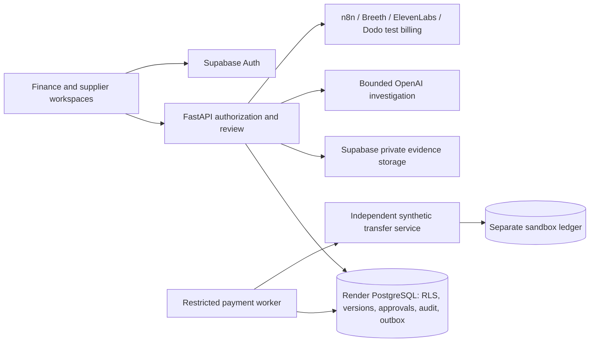

# PayVigil

**Investigate supplier-payment changes before approving the payment.**

PayVigil is an AI-assisted payment review workspace for Indian MSMEs. It brings
invoices, supplier instructions, accepted beneficiary details and payment history
into one investigation. A bounded AI agent highlights conflicting evidence and
cites its sources; authorized people decide what to accept and pay.

For example, an invoice for ₹1,25,000 may request a different destination from
the one the business previously accepted. PayVigil helps finance investigate the
change, collect the assigned supplier's confirmation, and approve one exact
payment revision with a traceable decision history.

**Current scope:** supplier transfers are simulated in an independent payment
sandbox. Dodo is used for test subscription billing for PayVigil itself. This
repository does not provide real banking integration, account-ownership
verification or a validated fraud-detection guarantee. Live provider checks and
public application deployment remain release prerequisites.

## How it works

1. Upload an invoice and supporting text/PDF evidence into private storage.
2. Run a bounded AI investigation against the evidence and current payment data.
3. Review source citations, contradictions and missing information.
4. Obtain supplier confirmation and separately accept any beneficiary change.
5. Approve an immutable payment revision: amount, destination and evidence context.
6. Queue a sandbox transfer and reconcile it against a separate persisted ledger.

A changed amount or beneficiary invalidates an earlier approval. An unknown
execution outcome blocks replacement until independent readback resolves it.
The AI, memory, voice, billing and delivery integrations cannot approve a payment,
accept a beneficiary or remove an execution hold.

## Architecture



The backend is organized by domain. Routes handle transport and verified identity;
domain services enforce workflow rules; typed schemas validate requests and
responses; models and Alembic migrations define persisted state. External calls
live behind bounded provider adapters. See [architecture](docs/ARCHITECTURE.md).

```text
backend/
  app/
    core/             # Configuration, identity, tenant scope and shared safeguards
    payments/         # Supplier versions, approvals, audit, outbox and worker
    evidence/         # Private ingestion, extraction and AI investigation
    integrations/     # Confirmation delivery, memory/voice support and billing
    main.py           # FastAPI application factory and composition
  migrations/         # Versioned PostgreSQL schema and permissions
  tests/              # API, domain, isolation and provider-contract tests
frontend/
  src/components/     # Finance, supplier and evidence interfaces
  src/hooks/          # Authentication, API and authenticated-download lifecycle
  src/lib/            # Typed API clients, validation and shared utilities
sandbox_service/      # Independent synthetic transfer API and ledger
scripts/              # Build checks, local fixtures and controlled release tools
fixtures/             # Explicitly synthetic evidence only
local_demo/           # Loopback-only identity/storage fixtures; never deploy
.github/              # CI and dependency update configuration
```

## Local development

Use the Python and Node versions in [.python-version](.python-version) and
[.node-version](.node-version), and a disposable loopback PostgreSQL 17 instance.
Hosted PostgreSQL 18 has also passed the application's schema and role checks.

```sh
python3.13 -m venv .venv
.venv/bin/python -m pip install -r backend/requirements-dev.txt
npm --prefix frontend ci
```

Follow [the local demo runbook](docs/LOCAL_DEMO.md) to supply a local test admin
connection, generate isolated identities and start the app. Credentials are
provided through ignored environment files or a secret manager. The local demo
uses fake identities and funds and cannot be used as production authentication.

## Quality checks

```sh
.venv/bin/python -m ruff check .
.venv/bin/python -m ruff format --check .
.venv/bin/python scripts/check.py --postgres
```

The aggregate check requires `LOCAL_TEST_ADMIN_URL` for a disposable loopback
cluster. It creates isolated test databases and exercises migrations, RLS, payment
authority, provider contracts, independent-ledger HTTP behavior, frontend
boundaries and the production build. Linux CI also verifies the protected PDF
subprocess; macOS may reject its required hard memory limit.

CI runs without production credentials and scans committed history with Gitleaks.
Local test success does not establish live integration or deployment readiness.

## Configuration and release

[.env.example](.env.example) is an empty-credential reference. Keep actual values
in an ignored owner-only file or managed secrets. Only the public API origin and
Supabase URL/publishable key may enter browser builds. Database runtime roles,
worker access and migration credentials remain separate.

The [Render Blueprint](render.yaml) and [REST release tool](scripts/render_release.py)
prepare four services: API, static frontend, worker and independent sandbox.
Automatic deploys are disabled; release tooling provisions inert services first
and deploys an explicitly reviewed commit after configuration is verified.

```sh
.venv/bin/python scripts/render_release.py plan
```

This command is offline. Follow [the deployment runbook](docs/DEPLOYMENT.md) for
credential setup, hosted checks and rollback. `/api/health` is liveness;
`/api/ready` checks restricted PostgreSQL, Auth availability and private storage.
Provider status indicators distinguish configuration from verified operation.

Remaining release work includes hosted Auth/Storage and sponsor verification,
new-account ElevenLabs voice compatibility, controlled hosted end-to-end checks,
and infrastructure backup/restore validation. Existing `beforetransfer` schema,
role, bucket and protocol identifiers are retained for compatibility.

## Maintainer

- **Maintainer:** [Prem T H](https://github.com/Prem17th)
- **Repository:** [Prem17th/PayVigil](https://github.com/Prem17th/PayVigil)

## Project documentation

- [Architecture and trust boundaries](docs/ARCHITECTURE.md)
- [Local development and demo](docs/LOCAL_DEMO.md)
- [Render deployment](docs/DEPLOYMENT.md)
- [Database setup](docs/RENDER_DATABASE.md) and [Auth/Storage bootstrap](supabase/bootstrap.md)
- [Payment authority contract](docs/PHASE3_CONTRACT.md)
- [Integration contract](docs/INTEGRATION_CONTRACT.md)
- [Synthetic evidence fixtures](fixtures/evidence/README.md)
- [Phase plan and verification reports](docs/PHASE_PLAN.md)
- [Contributing](CONTRIBUTING.md) and [security reporting](SECURITY.md)

Hackathon track: **Track 3 — Bharat Business: AI for MSMEs & Workers**, according
to the team's event brief.
